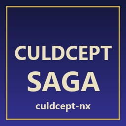

<div align=center>



</div>
<h1 align=center>Culdcept Saga — Nintendo Switch port</h1>

A native Nintendo Switch port of the Xbox 360 version of **Culdcept Saga** (OmiyaSoft / Jamsworks, Namco Bandai Games,
2008).

It's not an emulator. The PowerPC code of the game's `default.xex` is statically recompiled to C++ with
[ReXGlue](https://github.com/rexglue/rexglue-sdk) and compiled for the Switch, and the game's Direct3D calls are drawn
directly on the Switch GPU's own API, deko3d, by [reNut](https://github.com/masterspike52/reNut)'s Direct3D-level renderer.
It is built on [renut_nx_ultimate_base](docs/base-readme.md), which carries the fixes and optimisations of the other ports.

> [!NOTE]
> You need your own copy of the Xbox 360 disc (a disc image, `.iso`, or the folder it was extracted to). No title update
> or DLC is needed.

## How to install

1. Open the installer page, [culdcept-nx-installer](https://github.com/ChanseyIsTheBest/culdcept-nx-installer) (Chrome
   or Edge recommended).
2. Choose your game: its **disc image** (`.iso`) or the **folder** you extracted it to. Leave the two re-encode options
   ticked and press **Create culdcept-nx.zip**. Everything runs in your browser and the game files never leave your
   computer: the page checks your copy, downloads the program, and makes the game folder smaller (about 4.7 GB down to
   2.6 GB):
   - the archives and effects packed with LZ4 and ZXC (the game reads them as they were);
   - the movies re-encoded to H.265, which the Switch's video hardware plays (needs a browser with an H.265 encoder:
     Chrome or Edge on a recent graphics card; otherwise they stay WMV);
   - the music and sound effects re-encoded to Opus, the music at 128 kbit/s (the voices stay as they are).
3. Extract the downloaded `culdcept-nx.zip` to the root of the SD card: it makes `switch/culdcept-nx/`.
4. In Sphaira, find the game, press X for Options and choose **Install Forwarder**. Set **Address Space** to **39-bit**,
   choose Create Forwarder, then start the game from the Home screen.

```text
/switch/culdcept-nx/
  culdcept-nx.nro
  culdcept.toml             (your settings; written at the first start when it is missing)
  game_root/                (your game's files, as the installer wrote them)
```

The game keeps its saves in `renut/` there, and adds `cache/` (an index of the game folder, so later starts skip
listing it) and `deko3d_shaders.bin` (its seven shaders compiled for the Switch GPU, a second or two at the first start).

If you have an older version, delete its `switch/culdcept-nx/game_root` folder first: an unpacked file left there is
used instead of the packed one. A game folder copied from the disc as it is (no installer) works too, just larger.

To build everything yourself instead, see [docs/building.md](docs/building.md).

## Controls

By default the face buttons work **by position, as on the Xbox 360 pad** the game was made for: the bottom button is the
Xbox's A, the right one is the Xbox's B, and so on.

<div align="center">

| Switch | Xbox 360 |
| --- | --- |
| B (bottom) | A |
| A (right) | B |
| Y (left) | X |
| X (top) | Y |
| ZR / ZL | RT / LT |
| R / L | RB / LB |
| + | Start |
| − | Back |
| Sticks / D-pad | Sticks / D-pad |

</div>

**Two players:** every controller is its own player, in the order they connect (handheld counts as one). Single
Joy-Cons are held sideways, one per player. **L + R + ZR** opens the system's controller screen.

**The game menu:** **A + B + X + Y + L + R** (all at once) opens the port's own menu; + closes it.

## Settings

The game menu changes these and writes them to `culdcept.toml`:

<div align="center">

| Setting | Choices |
| --- | --- |
| Language | the system's, or one of the game's |
| Handheld resolution | 960x540 to 1280x720 (default 1280x720) |
| Docked resolution | 1280x720 to 1920x1080 (default 1920x1080) |
| Rumble | on (default) / off |
| MSAA | off (default), 2x, 4x |
| Four cores | on (default) / off. It takes effect once `culdcept.toml` names your forwarder (`banjo_forwarder_program_id`): the forwarder's next launch gets four CPU cores instead of three. Highly recommended |
| Xbox button layout | on (default: by position) / off (by letter) |
| Joy-Cons sideways, and their stick | on (default) / off |
| The menu's buttons, colour, font and background | as you like |

</div>

`culdcept.toml` also holds each player's button map (`[input_p1]`, `[input_p2]`). Delete it and the game writes the
default one again at the next start. The test settings (logs, profiling, A/B runs) are described in the package's
README.txt.

## Performance

The port runs at the console's stock clocks on three cores, 720 lines in handheld and 1080 docked. The released NRO is
built with link-time optimisation and PGO trained on a full replay of a game. The title, menus and board hold 60 fps
on average; the board still has short drops when the game loads its data (1 % lows of 12-16 fps in the last console
session), worked on in [docs/culdcept-notes.md](docs/culdcept-notes.md).

## How it works

- **The game's code is translated, not emulated.** ReXGlue translates every function of the game's program to C++,
  which is then compiled for the Switch, and gives the game what it expects from an Xbox 360: its system, files, audio
  and controllers. The game's hottest functions run as native ARM code or as machine-optimised copies, each checked
  against the generated original.
- **A Direct3D-level renderer on deko3d.** The game's Direct3D calls are drawn by reNut's renderer with
  [plume](https://github.com/renderbag/plume) on [deko3d](https://github.com/devkitPro/deko3d): no GPU command stream is
  written or parsed and no EDRAM is modelled. The game's seven shaders are built into the NRO.
- **Smaller game files, read as they were.** The packed files (LZ4 and ZXC in blocks) are decompressed as the game reads
  them. A movie in H.265 is decoded by the Switch's video hardware (NVDEC, through FFmpeg's nvtegra backend) in place of
  the game's WMV decoder. A sound in Opus (`NAME.xma.xmo`) is shown to the game as its XMA file, frame for frame, and
  each frame's samples come from the Opus stream: loops and timing stay the game's own.

## Documentation

<div align="center">

| Document | What it explains |
| --- | --- |
| [docs/building.md](docs/building.md) | Building the PC test build, the NRO, PGO, and the tests |
| [docs/culdcept-notes.md](docs/culdcept-notes.md) | The port step by step: findings in the game's code, the console measurements, the movies and the audio |
| [docs/console-testing.md](docs/console-testing.md) | What to run on the console and what the logs say |
| [docs/optimising-functions.md](docs/optimising-functions.md) | How the game's functions are made faster |
| [docs/base-readme.md](docs/base-readme.md), [docs/ultimate-fixes.md](docs/ultimate-fixes.md) | The base this port is built on and every fix it carries |
| [docs/progress-log.md](docs/progress-log.md) | The work in order |

</div>

## Credits

- **OmiyaSoft, Jamsworks and Namco Bandai Games** — creators of Culdcept Saga. This is an unofficial, fan-made port with
  no affiliation.
- **ChanseyIsTheBest** — this port.
- **[Tom Clay](https://github.com/rexglue/rexglue-sdk)** — the ReXGlue SDK, built on the work of the
  **[Xenia](https://xenia.jp)** team.
- **[StevensND](https://github.com/StevensND/nfsmw-nx)** — nfsmw-nx: the Switch layer of the SDK and much of the method;
  and nfsmw-nx-installer, the installer page this port's is built on.
- **reNut and [masterspike52](https://github.com/masterspike52/reNut)** — reNut's Direct3D-level renderer (reused with its
  author's permission).
- **[plume](https://github.com/renderbag/plume)**, **[deko3d](https://github.com/devkitPro/deko3d)** and
  **[uam](https://github.com/devkitPro/uam)** by fincs.
- **[devkitPro](https://devkitpro.org) and [switchbrew](https://github.com/switchbrew/libnx)** — devkitA64, libnx and the
  portlibs (FFmpeg with averne's nvtegra backend, libopus).
- **[FFmpeg](https://ffmpeg.org)**, **[LZ4](https://github.com/lz4/lz4)**, **[ZXC](https://github.com/hellobertrand/zxc)**
  and **[Opus](https://opus-codec.org)**.
- The sibling ports (katamari-nx, rr6-nx, sasrt-nx, banjo-nx, blur-nx and the others in
  [docs/base-readme.md](docs/base-readme.md)), which share their fixes with this one.
- The other libraries listed in [THIRD_PARTY_NOTICES.md](THIRD_PARTY_NOTICES.md).

## Legal

No affiliation with OmiyaSoft, Bandai Namco, Microsoft or Nintendo. "Culdcept" is a trademark of OmiyaSoft; the icon is
the game's artwork. This repository contains no game files and no code generated from the game. Users must provide
their own legally obtained copy, and everything made from it (`app/generated/`, the installer's files) is made on their
own computer. Running homebrew requires custom firmware, which violates Nintendo's ToS and can get a console banned —
your call.

Source code is provided under the GPL-3.0 License (see [LICENSE](LICENSE)), like the ports it builds on. The SDK keeps its
BSD-3-Clause license (see [THIRD_PARTY_NOTICES.md](THIRD_PARTY_NOTICES.md)).
